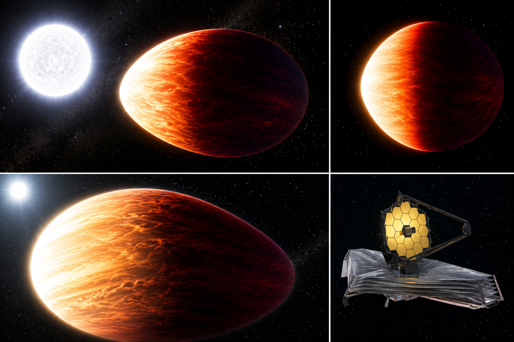

# WASP-121 b — Exoplanet Atmosphere Report
<!-- RESEARCH-IDENTITY-START -->
**Independent research report by [Biswajit Jana](https://biswajit1999.github.io/Biswajit_Jana.github.io/)** · [Live report](https://biswajit1999.github.io/wasp-121b-exoplanet-report/) · [ORCID](https://orcid.org/0009-0002-2411-1891) · [Complete research portfolio](https://biswajit1999.github.io/Biswajit_Jana.github.io/research/exoplanets/)
<!-- RESEARCH-IDENTITY-END -->


<p align="center">
  
</p>

<p align="center"><em>AI-generated artist's concept — not a real photograph. See the report for actual JWST NIRSpec/G395H data.</em></p>

An ultra-hot Jupiter on a 1.27-day orbit, tidally distorted by its host
star. This repo audits a public JWST NIRSpec/G395H phase-resolved emission
dataset in both the directly measured planet/star flux-ratio space and the
derived brightness-temperature space. Detector-band phase curves are kept
separate, while the temperature contrast remains explicitly non-bolometric.

**[Open the full report](https://biswajit1999.github.io/wasp-121b-exoplanet-report/)** — the live GitHub Pages version. You can also open `index.html` locally in a browser, or serve it with `python -m http.server` from this directory.

## Research evidence and downloads

[Open the evidence browser](https://biswajit1999.github.io/wasp-121b-exoplanet-report/evidence.html) for 11 selected files, including [`analysis_summary.json`](figures/analysis_summary.json). Each file has a download link and SHA-256 digest.

Rebuild the inventory and browser with `python scripts/evidence_catalog.py` and `python scripts/render_evidence_page.py`.

## Data sources

- **System parameters** — from the NASA Exoplanet Archive TAP
  service (`pscomppars` table).
- **Phase-resolved emission spectrum** — Zenodo v8 JWST NIRSpec/G395H
  planet/star flux ratio and brightness temperature as functions of wavelength
  (349 channels, 2.7-5.2 microns) and orbital phase (36 out-of-transit/eclipse
  bins), from
  Evans-Soma, Sing et al. (2025), released publicly on Zenodo
  ([10.5281/zenodo.20651891](https://doi.org/10.5281/zenodo.20651891)).
- **Analysis** — `scripts/analyze_spectrum.py` constructs separate NRS1 and
  NRS2 flux-ratio phase curves, fits descriptive first harmonics, and retains
  the phase-window brightness-temperature comparison as a secondary spectral
  view. Every fit is labelled with its diagonal-error limitation. Run it:

  ```bash
  pip install -r requirements.txt
  python scripts/analyze_spectrum.py
  ```

## Repository structure

```text
index.html              the report webpage
data/                    seven pinned JWST NIRSpec/G395H Zenodo v8 products
scripts/analyze_spectrum.py   detector phase curves + temperature audit
scripts/validate_data.py      cross-platform source identity and shape checks
figures/                 generated figure, CSV phase curves, summary CSV/JSON
tests/                   analytic, regression, failure-mode, and output tests
```

## Tests

`tests/test_analysis.py` checks the per-wavelength weighted-mean
function against a hand-computed case (including that a zero-error
point gets zero weight rather than dominating the mean), and reruns
the full pipeline on the real downloaded phase curve, verifying it
still reproduces the numbers this README documents — including the
explicit "not bolometric" label staying attached to the scalar
temperature. Runs automatically on every push via GitHub Actions; run
locally with:

```bash
pytest tests/ -v
```

## What the numbers show

The detector-band flux curves are the primary result. Descriptive first-
harmonic fits peak 2.934° (NRS1) and 2.358° (NRS2) before eclipse. Their
conjunction estimates are 3915/158 ppm for NRS1 and 4910/620 ppm for NRS2
(eclipse/transit). These same-observation estimates closely track the
published broadband values and hotspot offsets; they are a reproducibility
cross-check, not independent confirmation. Reduced χ² values of 14.36 and
13.07 show that a first harmonic plus diagonal formal errors is inadequate for
parameter inference, so this repo does not attach detection significance or
physical uncertainty to those descriptive offsets.

The secondary temperature view gives wavelength-averaged monochromatic values
of 2722.1 ± 1.7 K for dayside-facing bins and 1237.5 ± 3.3 K for
nightside-facing bins, with a 1493.2 ± 3.8 K contrast. These tiny formal errors
must not be interpreted as uncertainties on hemisphere effective temperatures.

## Limitations

Detector-band averages assume independent wavelength-channel errors, although
the release provides no inter-channel covariance. The large harmonic-fit
reduced χ² values empirically warn against using those formal errors for
inference. The phase bins exclude the transit and eclipse themselves, so
conjunction values are model interpolations across gaps.

Brightness temperature is wavelength dependent—different channels
probe different opacities and pressures — so the ± 3-4 K quoted above
is the statistical precision of averaging monochromatic values across
this bandpass, not a physical uncertainty on a bolometric hemisphere
temperature. The paper's own per-detector nightside values show this
directly: 926 ± 12 K on one NIRSpec detector (2.70-3.72 μm) versus
1122 ± 10 K on the other (3.82-5.15 μm) — a genuine ~200 K difference
between two broad bands. A separate NIRISS/SOSS phase-curve analysis
(Splinter et al. 2025), which explicitly models the part of the
spectrum this bandpass doesn't cover, derives bolometric effective
temperatures of Tday = 2717 ± 17 K and Tnight = 1562 ± 19 K — the
physically meaningful numbers for an energy-budget calculation, which
this repo's wavelength average is not intended to replace.

One point in the brightness-temperature uncertainty products is zero; it is
excluded from the relevant inverse-variance average rather than treated as
infinitely precise. The flux-ratio uncertainty matrix contains no zero values.

## References

1. Delrez, L. et al., 2016. WASP-121 b: a hot Jupiter close to tidal
   disruption transiting an active F star. *Monthly Notices of the Royal
   Astronomical Society*, 458(4), pp.4025-4043.
2. Evans, T.M. et al., 2017. An ultrahot gas-giant exoplanet with a
   stratosphere. *Nature*, 548, pp.58-61.
3. Evans, T.M. et al., 2018. Detection of H2O and Evidence for TiO/VO in an
   Ultra-Hot Exoplanet Atmosphere. *The Astrophysical Journal Letters*, 822,
   L4.
4. Evans-Soma, T.M., Sing, D.K. et al., 2025. SiO and a super-stellar
   C/O ratio in the atmosphere of the giant exoplanet WASP-121b.
   *Nature Astronomy*, 9(6), pp.845-861 (arXiv:2506.01771).
5. May, E.M. et al., 2023. A JWST NIRSpec Phase Curve for WASP-121b:
   Dayside Emission Strongest Eastward of the Substellar Point and
   Nightside Conditions Conducive to Cloud Formation. *The Astrophysical
   Journal Letters*, 943(1), L17 (arXiv:2301.03209).
6. Splinter, J. et al., 2025. Precise Constraints on the Energy Budget
   of WASP-121b from its JWST NIRISS/SOSS Phase Curve (arXiv:2509.09760).
7. Zenodo record
   [10.5281/zenodo.20651891](https://doi.org/10.5281/zenodo.20651891),
   "WASP-121b JWST NIRSpec/G395H data products."
8. NASA Exoplanet Archive, <https://exoplanetarchive.ipac.caltech.edu/>.

## Author

Biswajit Jana — [Portfolio](https://biswajit1999.github.io/Biswajit_Jana.github.io/) · [GitHub](https://github.com/Biswajit1999) · [LinkedIn](https://www.linkedin.com/in/biswajit-jana-27011a151/) · [ORCID](https://orcid.org/0009-0002-2411-1891)
